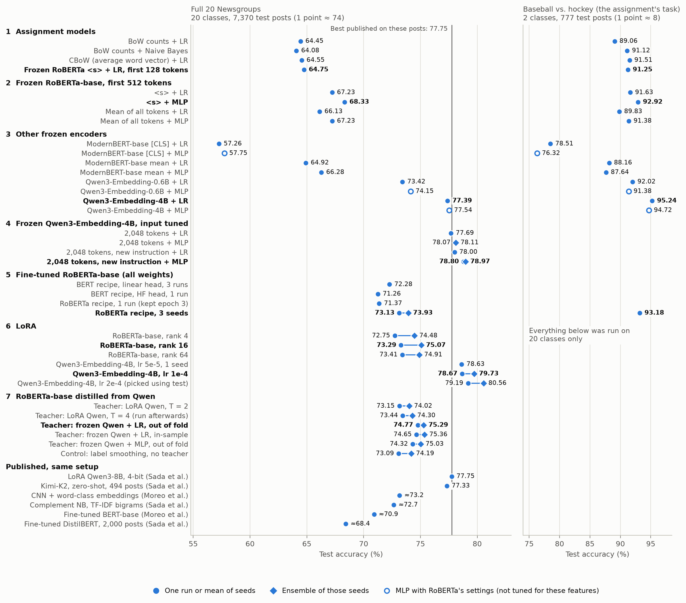

# How far can one 16 GB GPU go on 20 Newsgroups?

An extension of Assignment 2 in UBC's CPSC 423, Natural Language Processing (actual assignment code not shown, naturally). The assignment classifies baseball vs. hockey posts, where even bag-of-words reaches about 90%. So I moved to all 20 classes with the metadata removed, and pushed accuracy as far as I could under one rule: everything had to run on one consumer GPU (RTX 5070 Ti, 16 GB).

**Result: 64.75% → 79.73%.** That's from the assignment's frozen RoBERTa + logistic regression (LR) to an ensemble of 3 LoRA-fine-tuned Qwen3-Embedding-4B models. The best published result I found on the same posts is 77.75%.

- **The encoder mattered most.** Swapping it gained 10 points. Tuning the classifier on top gained about 1.
- **Fine-tuning helped RoBERTa a lot, but barely helped Qwen.** A full fine-tune gained RoBERTa 4.8 points. LoRA, the only option for Qwen on this GPU, practically tied its frozen model.
- **A less accurate teacher taught better.** Distilling into RoBERTa gained nothing from a 78.68% teacher that had memorized its training posts, and 1.64 points from a 77.72% teacher that hadn't.

*Every result, roughly in the order I tried things; section numbers match the steps below. With a diamond, the left number is the mean of the seeds (3 for trained models, 10 for frozen MLPs) and the right one is their ensemble. ≈ marks a published number [converted to my test posts](#compared-with-published-results).*

## The task

20 Newsgroups with `remove=('headers', 'footers', 'quotes')`, as [scikit-learn recommends](https://scikit-learn.org/stable/datasets/real_world.html#the-20-newsgroups-text-dataset), since the metadata gives the class away. The standard split is by date, so test posts are later than training posts. Without empty posts: 11,096 train, 7,370 test (1 point = 74 posts).

## The journey

"Frozen" means the encoder's weights stay fixed and only a classifier on top trains.

**1. Baseline: about 64.** On 20 classes, the assignment's models land within a point of each other, from Naive Bayes (64.08) to frozen RoBERTa + LR (64.75).

**2. Tune frozen RoBERTa: 68.33.** The assignment's spaCy pipeline only shows RoBERTa each post's first 128 tokens. Reading 512 gained 1.7 points (p = 2e-8), more than any LR tuning (at most 0.4, not significant). A tuned MLP reached 68.33. The representation was a bottleneck, not just the classifier.

**3. Swap the encoder: 77.39.** Qwen3-Embedding-4B was chosen as it's a popular model that is near the top of the [MTEB leaderboard](https://huggingface.co/spaces/mteb/leaderboard) and fits my chosen compute constraint. Frozen Qwen3-Embedding-4B + LR scored 10 points higher without training an encoder weight. Newer alone didn't help: [ModernBERT](https://arxiv.org/abs/2412.13663) peaked at 66.28, falling short of the smaller and older RoBERTa. [RoBERTa](https://arxiv.org/abs/1907.11692) was pre-trained to fill in masked words, so nothing asked its `<s>` to summarize a post, while [Qwen3-Embedding](https://arxiv.org/abs/2506.05176) is an LLM trained further on over 150M text pairs to make its last token that summary; under causal attention, only that token has seen the whole post. On the assignment's own task, Qwen3-Embedding-4B + LR scores 95.24, vs. 91.25 for the assignment's model.

**4. Tune Qwen's input: 78.97.** Reading 2,048 tokens instead of 512 barely helped, because the errors are in short posts: in CV, 41% of posts up to 64 tokens were wrong, vs. about 10% of those over 512. A better instruction ("Classify the given Usenet newsgroup post by the newsgroup it was posted to"), with [thread-grouped tuning](#how-i-kept-the-numbers-honest), gained 0.85 on an MLP ensemble (p = 0.004).

**5. Fine-tune RoBERTa: 73.13.** Training all 125M weights gained about 5 points over frozen, but stayed 5 below frozen Qwen. A better starting representation beat fine-tuning a weaker one.

**6. LoRA: 78.67, ensemble 79.73.** Fully fine-tuning Qwen's 4 billion weights would take about 68 GB, at 16 bytes per weight (32-bit weight, gradient, AdamW's two averages). LoRA ([Hu et al. 2022](https://arxiv.org/abs/2106.09685)) freezes them and trains small low-rank matrices beside them: rank 16 on all 7 projection matrices of all 36 layers, 0.8% of the weights, 9.6 GB peak.
- **It practically tied the frozen model.** The ensemble is my best result, but leads the frozen ensemble by only 0.76 (p = 0.018).
- **LoRA wasn't the limit, at least on RoBERTa,** where a full fine-tune fits. LoRA tied it (73.29 vs. 73.13) training 2.6% of the weights, and its ensemble was better (75.07 vs. 73.93, p = 0.0004), since its seeds disagree more.
- **Tuning moved nothing.** Qwen's learning rate and RoBERTa's rank each moved the 3-seed mean by under 1 point, while the seed alone moved a run by up to 1.2. Averaging 3 seeds gained more: 1.1 to 1.8 points.

**7. Distill Qwen into RoBERTa: 74.77, ensemble 75.29.** Can a model with 1/32 of the weights inherit Qwen's edge? Distillation ([Hinton et al. 2015](https://arxiv.org/abs/1503.02531)) trains a student on the teacher's full probability distribution, whose small probabilities say what a post resembles: a Mac hardware post is more like PC hardware than hockey. That's often called "dark knowledge", from Hinton's [2014 talk](https://www.ttic.edu/dl/dark14.pdf); the paper itself says "relative probabilities of incorrect answers".
- **LoRA Qwen as the teacher: no effect** (73.15 vs. 73.13 plain). It had memorized the posts it was labeling: 98.2% right, with a median of 1.6% of the probability off the true class at T = 2. Its soft labels were nearly the hard ones.
- **Frozen Qwen + LR as the teacher: +1.64** (ensembles: p = 1e-5). Each post's label came from an LR fitted on the other 9 folds. This teacher is a point *less* accurate, which fits [Cho & Hariharan 2019](https://arxiv.org/abs/1910.01348)'s "more accurate teachers often don't make good teachers", though the two also differ in calibration and input length.
- **Controls.** [Label smoothing](https://arxiv.org/abs/1512.00567) at the teacher's average softness gained nothing (−0.04), so the gain is the teacher's information, not softer targets. The same LR on its own training posts did about as well (+1.52), being regularized enough to get only 88% of them right. A more accurate teacher, frozen Qwen + MLP, taught no better (+1.19, p = 0.23).

## What each option costs

| Option | Weights trained | Peak GPU memory | Time | Test: mean / ensemble |
|---|---|---|---|---|
| Frozen Qwen3-Embedding-4B + LR | classifier only | 9.3 GB | one encoding pass (18 min at 512 tokens), then seconds | 78.00 |
| LoRA Qwen3-Embedding-4B | 33M of 4,022M | 9.6 GB | 49 min per run | 78.67 / 79.73 |
| Full fine-tune of Qwen3-Embedding-4B | all 4,022M | about 68 GB (estimated) | doesn't fit, not run | |
| Fine-tuned RoBERTa-base | all 125M | 5.2 GB | 7 min per run | 73.13 / 73.93 |
| LoRA RoBERTa-base | 3.3M of 125M | 5.1 GB | 8 min per run | 73.29 / 75.07 |
| Distilled RoBERTa-base | all 125M | 5.2 GB | 8 min per run, plus the teacher | 74.77 / 75.29 |

**What I'd use:** frozen Qwen + LR, since a LoRA run beats it by under a point for 49 minutes of training. If each prediction must be cheap, the distilled RoBERTa has 1/32 of the weights and costs 3 to 4 points.

## Compared with published results

Only results on the same task: all 20 classes, headers, footers and quotes removed, standard split. I found two papers. Both keep the 162 empty test posts, which cannot be predicted much better than chance, so I converted their numbers to my 7,370 posts: exactly from per-post predictions where published, otherwise estimated (≈). Moreo et al.'s micro-F1 equals accuracy on single-label data.

| Source | Model | As reported | On my posts |
|---|---|---|---|
| [Sada et al. 2026](https://arxiv.org/abs/2609.13185) | LoRA Qwen3-8B chat model (4-bit, attention only, 256 tokens) | 76.3 | 77.75 |
| | Kimi-K2 (1T weights), zero-shot, first 500 posts | 76.4 | 77.33 (494 posts) |
| | Complement Naive Bayes, TF-IDF bigrams | 71.2 | ≈72.7 |
| [Moreo et al. 2021](https://doi.org/10.1007/s10618-020-00735-3) | CNN on GloVe + word-class embeddings | 71.7 | ≈73.2 |
| | Fine-tuned BERT-base | 69.5 | ≈70.9 |
| **This project** | LoRA Qwen3-Embedding-4B: mean of 3 / ensemble | | **78.67 / 79.73** |
| | Distilled RoBERTa-base: mean of 3 / ensemble | | 74.77 / 75.29 |

- **Sada et al.'s LoRA, post by post:** one of my runs leads by 0.9 (p ≈ 0.02) and the ensemble by 2.0 (p = 9e-8). But their paper asks whether Naive Bayes should be retired, so that run is an untuned reference point, not the best this setup allows.  It also fine-tunes the general Qwen3-8B chat model, not the Qwen3-Embedding that I used.
- **Kimi-K2 may be just as good, with no training:** my ensemble scores 80.16 on its 494 posts (p = 0.14), too few to separate them.
- **A tuned bag-of-words is level with a fine-tuned RoBERTa** (≈72.7 vs. 73.13), so the assignment's Naive Bayes undersells classical models.

**Results that beat mine keep the metadata:**
- [Scherp et al. 2026](https://arxiv.org/abs/2204.03954): fine-tuned RoBERTa-base on full posts, 86.8, about 14 points above mine. The highest number in their review is MHGAT at 92.7, which they couldn't verify independently.
- [Zhao et al. 2025](https://arxiv.org/abs/2412.08587) (preprint): fully fine-tuned Llama-3-70B on full posts, 91.9, on 8 A100s.
- [Arras et al. 2017](https://arxiv.org/abs/1612.07843): bag-of-words + SVM, 80.1. They remove only the headers, so quoted replies and signatures stay.

**I tested this.** With [the same fine-tuning recipe](fine-tuned/Fine-tuned%20Roberta%20Full%20Posts.ipynb) on full posts, metadata left in, RoBERTa-base scores 86.20 vs. 73.13 on stripped ones, on the same 7,370 test posts. On all 7,532 posts it scores 86.10, within a point of Scherp et al.'s 86.8, so nearly all of the gap is the data, not the fine-tuning. The 162 posts that are empty once stripped hold only metadata, yet score 81.48, against about 5% by chance. So full posts are the easier task, and the metadata leaks the class.

## How I kept the numbers honest

- **Test came last.** Settings were chosen through hyperparameter search by CV or on a dev set. For the trained models, the decision rule was written down first: under 1 point on the 3-seed mean counts as no effect.
- **Random CV folds leak threads.** 65% of dev posts had a thread-mate in training, vs. 32% of test posts. That inflated CV by about 3 points (81.5 random, 78.8 grouped, 77.7 test), so I grouped folds by thread.
- **A p = 0.0001 win that wasn't real.** One LoRA run at lr 2e-4 scored 79.88, 1.19 points above the same seed at 1e-4. Two more seeds gained 0.35 and 0.01. McNemar's test asks whether two trained models differ on these posts, not whether a setting helps across seeds. That look at test is why the graph's 80.56 is labeled "picked using test" and isn't my headline.

## Caveats

- **Qwen may have seen this dataset.** It isn't in Qwen3-Embedding's documented training data, but that list ends in "etc." and the data isn't public. If it trained on these labels, frozen Qwen vs. RoBERTa isn't like-for-like.
- **No full fine-tune of Qwen,** so I can't say whether LoRA fell short there or fine-tuning of any kind adds little.

## AI use
Almost all code and most of the write-up in this repo were generated by Claude Code (Opus 5.5), which also proposed most of the methods, such as LoRA, the out-of-fold teacher, thread-grouped folds, seed ensembles and McNemar's test. I set the direction: the 16 GB constraint, which encoders to try, a larger context window, tuning LoRA, distilling Qwen into RoBERTa, and comparing only with published results on the same setup.

## Files

- `frozen/` (steps 2 to 4): the notebooks for each encoder and the classifier searches (`hparam_search/`, `hparam_search_mean/`). The embedding caches aren't committed, at up to 189 MB each; the code that writes them is.
- `fine-tuned/`, `lora/`, `distilled/` (steps 5, 6 and 7): one notebook per experiment. LoRA is about 15 lines of plain PyTorch.
- `sweeps/`: the sweeps (`sweep.py`, `sweep_qwen_lora.py`), their logs and the trained models' saved predictions. `summarize.py` scores them, e.g. `python sweeps/summarize.py --final qwen_lora_lr1e-4 --select last`.
- `figures/`: the graph above and `make_all_results.py`, which draws it.
- `fine-tuning-results.md`: every number, protocol and decision rule (long).
